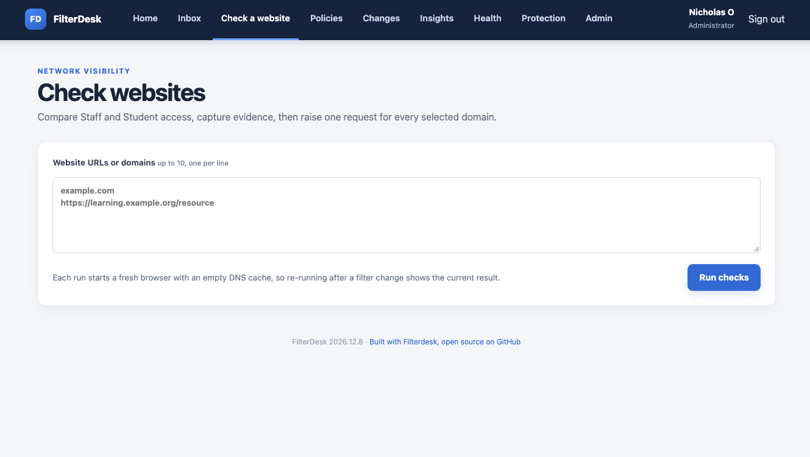
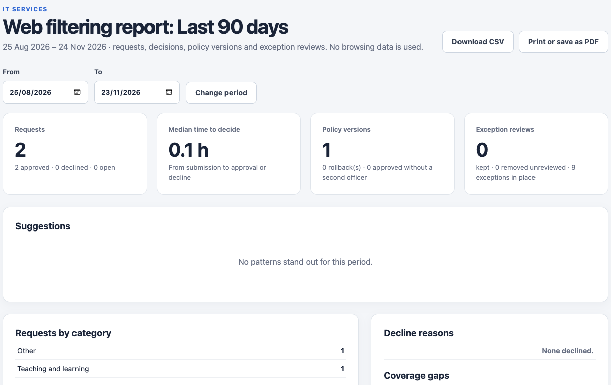
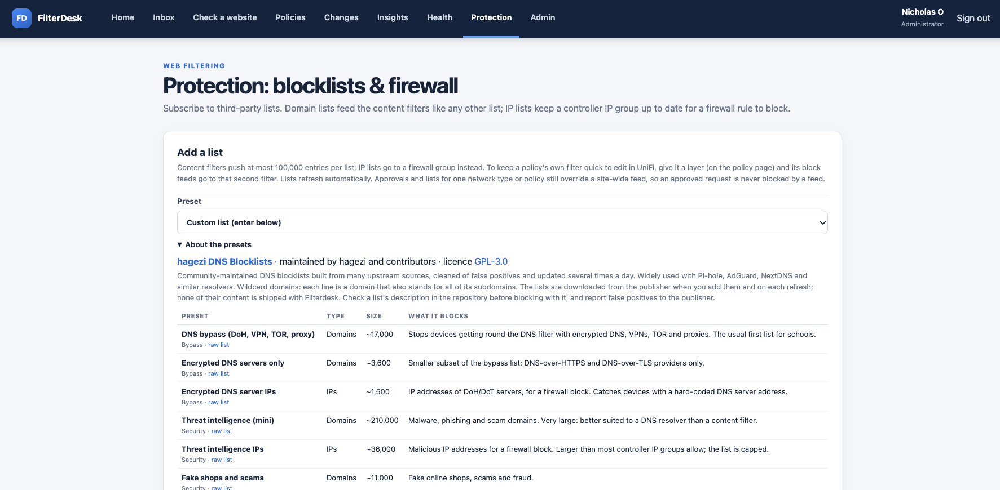

# Filterdesk

Filterdesk is an open-source, Docker-first self-service portal for schools. Staff check a website from the Staff and Student networks side by side (with a screenshot), then ask for it to be allowed, or blocked, for a while or permanently. IT gets an auditable workflow (questions, reassignment, approval, notifications, expiry) and the app keeps UniFi's content filters in step: it reads them, pushes approved changes with read-back verification, and treats UniFi as the source of truth.

The application is school-neutral: branding, identity, network profiles, policy and notifications are configured through the first-run wizard. UniFi Network is the first provider, behind a vendor-neutral interface.

## Screenshots

| | |
| --- | --- |
|  |  |
| **Check a website** from each network at once, with screenshots, then request access for whatever is blocked. | **Insights:** a termly report of requests, decisions, versions and reviews, with suggestions. No browsing data is used. |
|  |  |
| **Protection:** subscribe to DNS blocklists (such as hagezi) and IP lists that keep a UniFi firewall group up to date. | **Installation wizard:** branding, sign-in, UniFi, networks, email and approvals in eight steps. |

## Current capabilities

**Policy platform (2026.12)**

- **Changes and versions:** see exactly what publishing would write to the controller, publish it as one numbered policy version, and roll a version back as a whole. Every automatic push is a version too.
- **Two-person approval:** site-wide changes and sensitive categories need two IT officers.
- **Access explorer:** "can this network reach this site at this time, and why", traced step by step, with what-if for category changes and a plain *Why is this blocked?* page for staff and students.
- **School calendar:** terms, holidays, exam periods and bell times; recurring access that follows them, and exam mode per network type.
- **Exception reviews:** every exception has an owner and a review date; unreviewed ones are removed after a grace period.
- **Insights and Health:** a termly report with suggestions drawn from requests, and a coverage score with links to each fix.
- **Integrations:** API, signed webhooks, Microsoft Teams cards and one-click decision links; sign-in groups set network types and departments.
- **Filtering map:** pick a network and see every UniFi filter on it, the policy behind each one and the lists that fill them.
- **Protected sites:** a safety net so search, sign-in and update sites (google.com, bing.com, microsoft.com, apple.com…) are never blocked by a list, feed, scan, request or UniFi.
- **Quick block or allow:** IT blocks or allows a site on several network types at once, with a preview of the lists, UniFi filters, categories and conflicting entries first.
- **School-hours filters:** a school-hours filter (such as *Student - School Time*) becomes a layer of the always-on one. Blocks can apply in school hours only, chosen by IT or suggested by the requester; allows can apply outside school hours only.
- **Plain answers for students and staff:** website checks show *Allowed*, *Blocked* or *Couldn't check right now* per network. Page previews are for IT only unless you open them up, and checks can be DNS-only.
- **Help for staff and students:** a How to page, a *Need help?* box with your helpdesk's details and support article, and your own wording and sign-in logo.
- **Two-factor sign-in:** authenticator-app codes with recovery codes, required by default for IT and admin password sign-ins.

**Foundations**

- OpenID Connect sign-in (including Microsoft Entra ID) with just-in-time users
- Administrator-created local test users and passwordless OIDC placeholders
- Student, teacher, IT and administrator roles
- Parallel Student/Staff network checks with a target of 1–3 seconds
- Automatic Chromium screenshots and configurable block-page detection
- Batch website checks with blocked domains preselected into one access request
- Multi-domain staff-only or staff-and-student requests
- Portal embedding (Schoolbox or another) with an exact-origin allowlist, secure cross-site sessions and single sign-on in a popup
- Approval, rejection, reassignment, information requests and manual completion
- Explicit permanent access or temporary access windows with scheduled expiry
- Network types you define (Staff, Students, CCTV, Exam rooms…), each with shared allow and block lists, plus site-wide and per-policy lists
- Live UniFi content filters: read, push with read-back verification and rollback, sync checks, and the controller kept as the source of truth (edits made in UniFi are imported)
- Guided setup that brings every UniFi filter, list, network and category in with one click, ready to use
- Content categories, timed allow and block windows, and block requests as well as access requests
- Third-party DNS blocklists (such as hagezi) and IP blocklists pushed to UniFi firewall groups, with *layers* that keep big feeds in a second filter
- Per-policy reconciliation and copy-ready desired lists when pushing is off
- DNS-aware approval recommendations: registrable domain plus the subdomains and CDN hosts a page loads
- Fresh browser and uncached DNS on every check run, with Secure DNS disabled so it cannot bypass the filter
- Assignment to IT staff, internal notes, revoke, request queue filters and IT email alerts
- Post-install settings, OIDC role rules, audit log viewer and diagnostics
- Email decision notifications through a background queue
- Encrypted OIDC, SMTP and UniFi credentials
- UniFi official API connection/capability testing, defaulting to read-only
- First-run installation wizard which locks after completion
- Audit records, health checks, isolated containers and explicit proxy trust

## Setting it up

> **Full guide:** [docs/SETUP.md](docs/SETUP.md) has every step with checks and a reference for every `.env` variable. [docs/SECURITY_HARDENING.md](docs/SECURITY_HARDENING.md) is the security checklist, including post-quantum TLS. The steps below are the short version.

### 1. Requirements

- A Linux host with **Docker Engine 28+** and **Compose v2.33+** (`docker version`, `docker compose version`), about 4 GB free RAM for screenshots.
- A hostname and a reverse proxy with HTTPS (Nginx Proxy Manager, Caddy, Traefik or Nginx). For a quick local look you can skip this and use `http://127.0.0.1:8088`.
- A **UniFi API key** (see [UniFi API key](#unifi-api-key)). Optional: OIDC (for example Entra ID) and SMTP details.

### 2. Get the code and create `.env`

```bash
git clone https://github.com/nicksweb/Filterdesk.git filterdesk
cd filterdesk
./bin/install          # creates .env with a fresh APP_KEY, database password and probe key
```

Edit `.env`:

| Setting | Set it to |
| --- | --- |
| `APP_URL` | The address people will use, for example `https://filterdesk.example.edu.au` (or `http://127.0.0.1:8088` locally, with `SESSION_SECURE_COOKIE=false`). |
| `TRUSTED_PROXIES` | The address the reverse proxy connects **from**. Proxy on the host: `127.0.0.1`. Proxy in Docker: the shared network's subnet, `docker network inspect -f '{{range .IPAM.Config}}{{.Subnet}}{{end}}' frontend` (for example `172.18.0.0/16`). If it is wrong, pages load **without styling**. The wizard's first page shows the address it sees. |
| `APP_TIMEZONE` | Your timezone, for example `Australia/Brisbane`. |

### 3. Start it

Without a reverse proxy, or with one on the host itself (it reaches the app at `127.0.0.1:8088`):

```bash
docker compose pull && docker compose up -d
```

With a reverse proxy in another Docker container (such as Nginx Proxy Manager), join its network so it can reach the app by name:

```bash
cp compose.proxy.example.yml compose.proxy.yml   # set REVERSE_PROXY_NETWORK in .env if its network is not "frontend"
docker compose pull
docker compose up -d
```

and point the proxy host at `http://filterdesk-web:8080` (port **8080**, not 8088; see [SETUP step 6](docs/SETUP.md#6-set-up-the-reverse-proxy)). The images come from `ghcr.io/nicksweb/filterdesk-*`; the first pull takes a few minutes. To build from source instead, see [docs/SETUP.md](docs/SETUP.md#5-start-the-stack). `docker compose ps` should show `db`, `web` and both probes healthy.

### 4. Run the installation wizard

Open `APP_URL`. The wizard locks itself once finished.

1. **System checks:** database, encryption key, queue and reverse proxy. Fix anything marked `!` first.
2. **School:** name, timezone, URL, and the embedding origin if it will be embedded in Schoolbox or another portal.
3. **Administrator and sign-in:** the first local admin (password of 14+ characters), and optionally OIDC with role rules.
4. **UniFi:** local console key (console URL) or Site Manager key (console ID), and **Read-only** mode to start.
5. **Network access profiles:** keep `http://probe-student:3000` and `http://probe-staff:3000`; the network IDs can be filled in later.
6. **Email:** SMTP and the IT notification address.
7. **Approval policy:** auto-approval, student requests, default access length and categories.
8. **Review and complete**, then sign in as the administrator.

### 5. Bring UniFi in

The dashboard points you to **Policies → Guided setup**. **Bring everything in** reads every UniFi content filter and sets the tool up to match it: a policy per filter (the default Students and Staff policies are reused), every allow and block entry imported, networks mapped, categories kept, probe profiles prepared. Nothing changes in UniFi, and each policy's change set should be empty afterwards.

### 6. Put the probes on the VLANs

Out of the box the probes use Docker's own network, which is fine for a first look but not a real comparison: UniFi filters DNS per network, so each probe must sit on its policy's VLAN and use that VLAN's gateway for DNS. On the Guided setup page, under *Probe containers*:

1. Run `bin/probe-interfaces` on the host to find the trunk interface (and `sudo bin/probe-interfaces --listen <trunk>` to confirm the switch port sends the VLANs tagged). Enter it as the **trunk interface**; each probe uses `<trunk>.<VLAN>`. Tick **extra probes** for other networks (guest Wi-Fi, BYOD) and save.
2. Download `compose.vlan.yml` (or `docker compose exec -T app php artisan probes:compose > compose.vlan.yml`), run the `docker network create` commands at the top of it, add its `.env` lines, and restart with the extra file:

   ```bash
   docker compose up -d
   ```

3. **Create and link probe profiles**, enable each under *Settings → Network profiles*, and check the address, MAC, gateway and DNS each probe reports there.

Details: [probe containers on the VLANs](docs/DEPLOYMENT.md#probe-containers-on-the-vlans).

### 7. Try it, then go live

Check a few websites, raise a request, approve it, and compare the policy page with UniFi. When it behaves, set *Settings → Network provider* to **Active** (and optionally **Push automatically**) so the app pushes changes to UniFi. Report problems with the steps, the UniFi Network version and what *Health → Diagnostics* shows.

Keep PostgreSQL, PHP-FPM and the probes off the internet; the Compose file only publishes Nginx on `127.0.0.1`.

### Starting again

To wipe an install and run the wizard again (this deletes its database; UniFi is not touched):

```bash
docker compose exec -T db sh -c 'pg_dump -U "$POSTGRES_USER" -Fc "$POSTGRES_DB"' > filterdesk-backup.dump   # optional backup
docker compose down -v --rmi local
mv .env .env.old && ./bin/install
```

Keep `.env.old` with any backup: its `APP_KEY` is needed to read the encrypted credentials in it.

See the [setup guide](docs/SETUP.md), [security hardening](docs/SECURITY_HARDENING.md), [deployment and operations](docs/DEPLOYMENT.md), [upgrading](docs/UPGRADING.md), [policy reconciliation](docs/POLICY_RECONCILIATION.md), [architecture](docs/ARCHITECTURE.md), and [UniFi compatibility](docs/UNIFI.md).

## UniFi API key

Use an **official UniFi API key**, never a UI password. There are two kinds, and they are not interchangeable:

| Key | Where to create it | Connection setting | Reaches the console via |
| --- | --- | --- | --- |
| **Local key** | On the console: Network → Settings → Control Plane → Integrations | *Local console key* | `https://<console>/proxy/network/…` |
| **Site Manager key** | unifi.ui.com → API | *Site Manager cloud connector* | `https://api.ui.com/v1/connector/consoles/<id>/…` |

A Site Manager key sent to the local endpoint is rejected with HTTP 401. With the cloud connector, the key's owner must own the console and the console must be online. Use **Discover** in *Settings → Network provider* to list consoles, sites and networks.

Sites, networks and firewall IP groups use the official integration API. Content-filter lists and categories are not in the official API, so the app uses the Network application's own content-filtering endpoints, which accept the same key. It only reads them in **Read-only** mode; in **Active** mode every write is read back and verified, recorded, and can be rolled back. If a Network release changes those endpoints, calls fail with a clear message and IT can still copy lists by hand. See [docs/UNIFI.md](docs/UNIFI.md).

## Updating

Configuration and data are stored in `data/` (the database and storage, as bind mounts), outside the images. Back up first, then:

```bash
bin/update        # back up, pull, update compose.yml and bin/ scripts, restart
```

`bin/update` works in a git checkout (it runs `git pull --ff-only`, and stops first if you have local edits) and in a plain install folder (it copies the new `compose.yml`, example overrides and scripts out of the app image, keeping the old ones in `backups/`). To pin a release, set `FILTERDESK_VERSION` in `.env` first. By hand, the same is:

```bash
git pull --ff-only                       # newer compose.yml, docs and scripts
docker compose pull
docker compose up -d
```

The one-shot `migrate` service runs `php artisan filterdesk:upgrade` (migrations, backfills, cache clearing, worker restart) before workers start. Read [CHANGELOG.md](CHANGELOG.md) and [docs/UPGRADING.md](docs/UPGRADING.md) before each upgrade.

## Development

```bash
docker run --rm --user "$(id -u):$(id -g)" \
  -e APP_ENV=testing -e DB_CONNECTION=sqlite -e DB_DATABASE=:memory: \
  -v "$PWD:/app" -w /app php:8.5-cli php artisan test
```

Laravel Pint is the formatter. Provider integrations implement `App\Services\Network\NetworkProvider`; workflow and UI code do not depend on UniFi-specific response shapes.

## Security

Do not open public issues containing vulnerabilities, credentials, school names, internal domains, screenshots or topology. Follow [SECURITY.md](SECURITY.md). This software can be authorised to change network policy; validate it in read-only mode and apply least privilege. Work through [docs/SECURITY_HARDENING.md](docs/SECURITY_HARDENING.md) before going live. It also describes who can change filtering, and the latest security review (dependencies, images and access control).


## Third-party blocklists

The optional blocklist presets (Protection) point to [hagezi/dns-blocklists](https://github.com/hagezi/dns-blocklists), maintained by hagezi and contributors and published under GPL-3.0. Filterdesk does not include any list content: lists are downloaded from the publisher when an administrator subscribes and on each scheduled refresh. Review a list's description in that repository before using it, and report false positives to the publisher.

## Licence

Released under the [MIT License](LICENSE).
