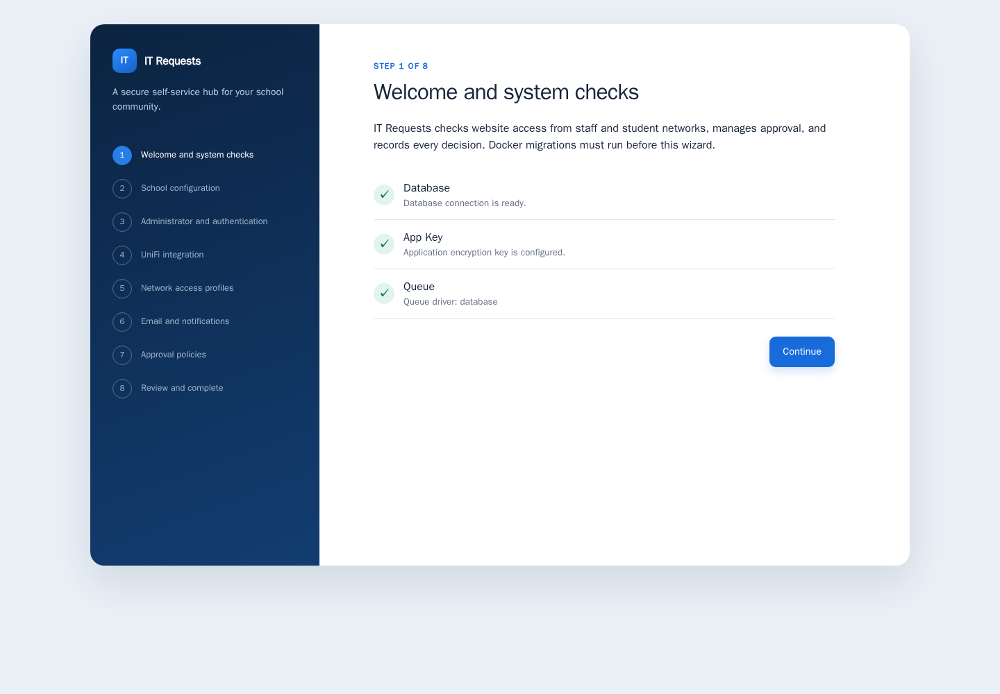

# IT Requests

IT Requests is an open-source, Docker-first self-service portal for schools. Staff can compare website access from Staff and Student network paths, capture a screenshot, and request that one or more domains be allowed. IT receives an auditable workflow for questions, reassignment, approval, manual/provider action, notifications, and temporary-access expiry.

The application is school-neutral: branding, identity, network profiles, policy and notifications are configured through the first-run wizard. UniFi Network is the first provider, behind a vendor-neutral interface.



## Current capabilities

- OpenID Connect sign-in (including Microsoft Entra ID) with just-in-time users
- Administrator-created local test users and passwordless OIDC placeholders
- Student, teacher, IT and administrator roles
- Parallel Student/Staff network checks with a target of 1–3 seconds
- Automatic Chromium screenshots and configurable block-page detection
- Batch website checks with blocked domains preselected into one access request
- Multi-domain staff-only or staff-and-student requests
- Schoolbox iframe embedding with an exact-origin allowlist and secure cross-site sessions
- Approval, rejection, reassignment, information requests and manual completion
- Explicit permanent access or temporary access windows with scheduled expiry
- Site-wide, audience (Staff/Student/Guest) and per-policy allow and block lists
- Per-policy reconciliation against pasted UniFi content-filter lists, with copy-ready desired lists
- DNS-aware approval recommendations: registrable domain plus the subdomains and CDN hosts a page loads
- Fresh browser and uncached DNS on every check run, with Secure DNS disabled so it cannot bypass the filter
- Assignment to IT staff, internal notes, revoke, request queue filters and IT email alerts
- Post-install settings, OIDC role rules, audit log viewer and diagnostics
- Email decision notifications through a background queue
- Encrypted OIDC, SMTP and UniFi credentials
- UniFi official API connection/capability testing, defaulting to read-only
- First-run installation wizard which locks after completion
- Audit records, health checks, isolated containers and explicit proxy trust

## Quick start

Requirements: Docker Engine 27+ with Compose v2, a dedicated hostname/reverse proxy, and 4 GB free RAM if screenshots are enabled.

```bash
git clone https://github.com/nicksweb/it-edu-selfservice.git itrequests
cd itrequests
chmod +x bin/install
./bin/install
```

Edit `.env` and set at least `APP_URL` and `TRUSTED_PROXIES`. Then:

```bash
docker compose up -d --build
docker compose ps
```

Open `http://127.0.0.1:8088` locally, or configure the reverse proxy first and open `APP_URL`. The installation wizard creates the initial administrator and configures the school, OIDC, UniFi, probes, email and approval defaults.

Do not expose PostgreSQL, PHP-FPM, or either probe to the internet. The supplied Compose file publishes only Nginx on loopback.

## Network probes and VLANs

The default probes use normal Docker egress, useful for evaluation but not a real comparison: UniFi filters DNS per network, so each probe must sit on its policy's VLAN and use that VLAN's gateway for DNS. After connecting UniFi, **Policy lists → Guided setup** plans one probe per policy (plus extra probes for any other network, such as guest Wi-Fi) and generates `compose.vlan.yml` with the host commands; see [probe containers on the VLANs](docs/DEPLOYMENT.md#probe-containers-on-the-vlans). To write it by hand instead, create one Docker macvlan/ipvlan network per access network, copy `compose.vlan.example.yml` to `compose.vlan.yml`, update `.env`, then start with:

```bash
docker compose -f compose.yml -f compose.vlan.yml up -d --build
```

Each probe must have the intended VLAN as its default route. If a UniFi block page resolves to a private hostname, explicitly list that hostname in `STUDENT_ALLOWED_PRIVATE_HOSTS` or `STAFF_ALLOWED_PRIVATE_HOSTS`; private targets are otherwise rejected to reduce SSRF exposure.

Point each probe at its VLAN's resolver for uncached lookups:

```env
STUDENT_PROBE_DNS_SERVERS=10.20.0.1
STAFF_PROBE_DNS_SERVERS=10.10.0.1
```

See [deployment and operations](docs/DEPLOYMENT.md), [upgrading](docs/UPGRADING.md), [policy reconciliation](docs/POLICY_RECONCILIATION.md), [architecture](docs/ARCHITECTURE.md), and [UniFi compatibility](docs/UNIFI.md).

## UniFi API key required

Use an **official UniFi API key**, never a UI password. There are two kinds, and they are not interchangeable:

| Key | Where to create it | Connection setting | Reaches the console via |
| --- | --- | --- | --- |
| **Local key** | On the console: Network → Settings → Control Plane → Integrations | *Local console key* | `https://<console>/proxy/network/integration/v1` |
| **Site Manager key** | unifi.ui.com → API | *Site Manager cloud connector* | `https://api.ui.com/v1/connector/consoles/<id>/…` |

A Site Manager key sent to the local endpoint is rejected with HTTP 401. With the cloud connector, the key's owner must own the console and the console must be online. Use **Discover** in *Settings → Network provider* to list consoles, sites and networks. Keep the integration **read-only** until testing succeeds.

The official API includes site/network discovery and firewall/ACL resources, but does not currently provide a portable content-filter *domain allowlist* operation across supported Network versions. IT Requests therefore reports that capability as unavailable, adds approved hostnames to the managed **Policy lists**, and places the request into **Action required** until IT copies the change into UniFi. It does not call undocumented controller endpoints. See [docs/UNIFI.md](docs/UNIFI.md).

## Updating

Configuration is stored in PostgreSQL and named volumes, outside the image. Back up first, then:

```bash
git pull --ff-only
docker compose build --pull
docker compose up -d
```

The one-shot `migrate` service runs `php artisan itrequests:upgrade` (migrations, backfills, cache clearing, worker restart) before workers start. Read [CHANGELOG.md](CHANGELOG.md) and [docs/UPGRADING.md](docs/UPGRADING.md) before each upgrade.

## Development

```bash
docker run --rm --user "$(id -u):$(id -g)" \
  -e APP_ENV=testing -e DB_CONNECTION=sqlite -e DB_DATABASE=:memory: \
  -v "$PWD:/app" -w /app php:8.5-cli php artisan test
```

Laravel Pint is the formatter. Provider integrations implement `App\Services\Network\NetworkProvider`; workflow and UI code do not depend on UniFi-specific response shapes.

## Security

Do not open public issues containing vulnerabilities, credentials, school names, internal domains, screenshots or topology. Follow [SECURITY.md](SECURITY.md). This software can be authorised to change network policy; validate it in read-only mode and apply least privilege.

Released under the [MIT License](LICENSE).

## Third-party blocklists

The optional blocklist presets (Policy lists → Blocklists & firewall) point to [hagezi/dns-blocklists](https://github.com/hagezi/dns-blocklists), maintained by hagezi and contributors and published under GPL-3.0. IT Requests does not include any list content: lists are downloaded from the publisher when an administrator subscribes and on each scheduled refresh. Review a list's description in that repository before using it, and report false positives to the publisher.
